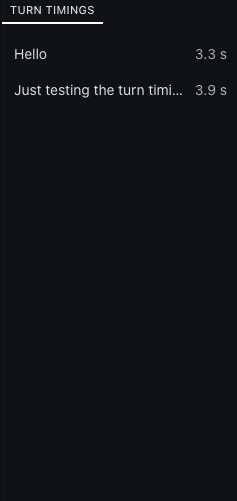

# Turn timings

A Hermes Desktop pane that shows how long turns take. It follows your selected chat, lists recent replies oldest first, and shows the running timer at the bottom. The package has no Python entry point or external dependencies.



## Install from Git

Requires Hermes Desktop with Hermes Agent 0.23.1 or later. Version 0.23.1 is the supported minimum and was tested on macOS.

1. In Hermes Desktop, open **Capabilities > Plugins > Install from Git**.
2. Enter `https://github.com/tapresle/hermes-turn-timings.git` and install the plugin. If the repository is private, your Git credentials need read access.
3. In **Capabilities > Plugins**, enable **Turn timings**, then open a chat. The pane appears to the right of the chat.

If you already have a standalone copy of `turn-timings`, it takes precedence over the package. Use a separate test environment to verify the packaged install without replacing your standalone copy.

To hide the pane without disabling the plugin, right-click inside it and choose **Minimize**. Click its collapsed rail to restore it.

## Data and limitations

The plugin reads chat history through the Hermes gateway to show short prompt labels. Its local storage contains durations keyed by connection, profile, and message row ID, not prompt text or replies. It does not send telemetry or contact external services directly.

The plugin does not backfill earlier turns. A reload during a turn can lose the in-memory start time. Background turns can only be recorded when Hermes delivers both events with enough routing information to identify the chat. A missing measurement is shown as **Not recorded**.

## Verify the package

```sh
node --check desktop/plugin.js
node --test tests/plugin.test.mjs
hermes plugins validate . --install-deps
```

## License

[MIT](LICENSE)
